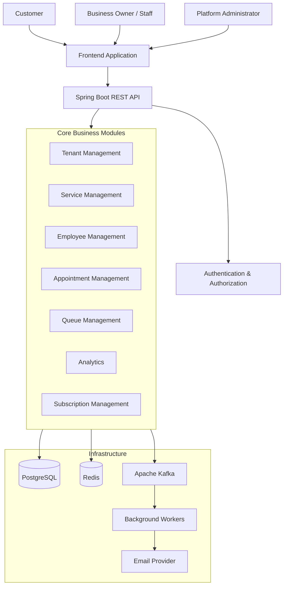
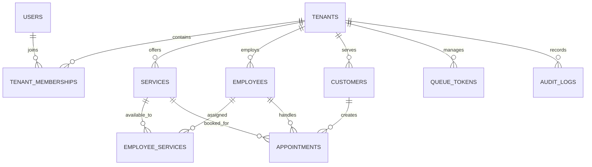
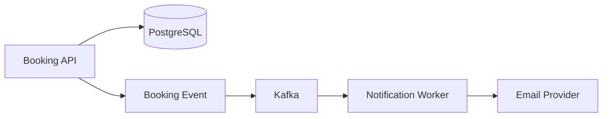
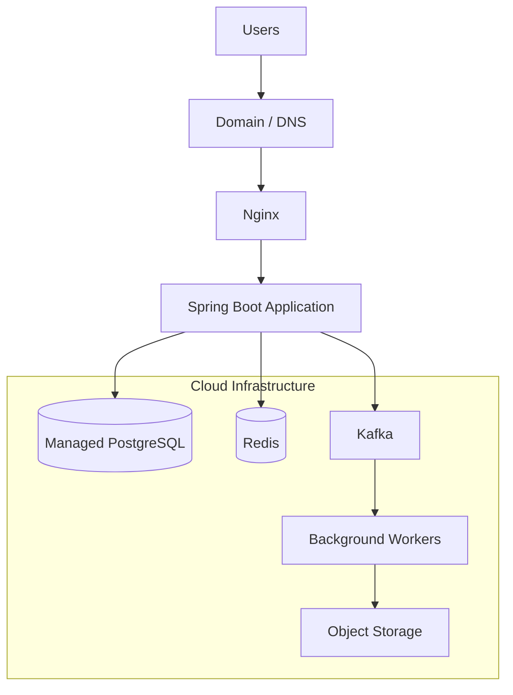

# SlotWise — Multi-Tenant Appointment, Queue & Business Operations SaaS

> **One platform to manage appointments, walk-ins, queues, staff schedules, and customer experiences.**

SlotWise is a multi-tenant SaaS platform designed to help service-based businesses digitize their appointment and queue management operations.

It provides businesses with a centralized workspace to manage services, employees, customer bookings, walk-in appointments, waiting queues, notifications, and operational analytics.

Customers can discover a business's services, check available time slots, and book appointments through a public booking page. Business owners and staff can manage their daily operations through a dedicated dashboard.

The project is being developed with a focus on **backend engineering, transactional consistency, multi-tenant architecture, distributed processing, application security, and production-ready software practices.**

---

## Table of Contents

- [1. Problem Statement](#1-problem-statement)
- [2. Proposed Solution](#2-proposed-solution)
- [3. Target Users](#3-target-users)
- [4. Key Features](#4-key-features)
- [5. User Roles and Permissions](#5-user-roles-and-permissions)
- [6. System Architecture](#6-system-architecture)
- [7. Technology Stack](#7-technology-stack)
- [8. Backend Architecture](#8-backend-architecture)
- [9. Database Design](#9-database-design)
- [10. Appointment Booking and Concurrency Handling](#10-appointment-booking-and-concurrency-handling)
- [11. Event-Driven Processing](#11-event-driven-processing)
- [12. API Design](#12-api-design)
- [13. Security](#13-security)
- [14. Testing Strategy](#14-testing-strategy)
- [15. Deployment and DevOps](#15-deployment-and-devops)
- [16. Observability and Reliability](#16-observability-and-reliability)
- [17. Project Structure](#17-project-structure)
- [18. Development Roadmap](#18-development-roadmap)
- [19. Local Development Setup](#19-local-development-setup)
- [20. Environment Variables](#20-environment-variables)
- [21. Engineering Challenges](#21-engineering-challenges)
- [22. Future Enhancements](#22-future-enhancements)
- [23. Contributing](#23-contributing)

---

## 1. Problem Statement

Many small and medium-sized service businesses still manage appointments and customer queues using phone calls, messaging applications, spreadsheets, or manual registers.

This creates several operational problems:

- Double-bookings caused by manual scheduling.
- Difficulty managing multiple employees and service schedules.
- No centralized visibility into daily appointments.
- Poor communication when appointments are delayed or cancelled.
- Unorganized walk-in customer management.
- Limited visibility into business performance.
- No reliable historical record of appointment activity.
- Time-consuming administrative work for business owners.

Existing enterprise appointment systems can also be unnecessarily complicated or expensive for smaller businesses.

SlotWise aims to address these problems through an accessible, centralized, and scalable appointment management platform.

---

## 2. Proposed Solution

SlotWise provides a shared platform where multiple independent businesses can manage their operations without interfering with one another.

Each registered business receives its own isolated workspace, staff accounts, services, booking configuration, and operational dashboard.

### How it works

1. A business registers and creates its workspace.
2. The business configures its services, employees, working hours, and appointment rules.
3. SlotWise generates a public booking page for that business.
4. Customers open the booking page and select a service, employee, date, and available time.
5. The platform validates availability and creates the appointment.
6. Staff members manage appointments and walk-in customers from their dashboard.
7. Notifications are processed asynchronously.
8. Business owners review operational analytics and appointment history.

### Product objectives

- Simplify appointment and queue management.
- Prevent conflicting bookings.
- Support multiple businesses on a single platform.
- Provide reliable customer and staff workflows.
- Reduce repetitive administrative tasks.
- Build a foundation for subscription-based SaaS operations.

---

## 3. Target Users

SlotWise is designed for businesses where customers book services or wait for their turn.

| Business category | Example use case |
|---|---|
| Clinics | Patient appointments and waiting queues |
| Salons | Employee-wise service bookings |
| Dental practices | Consultation scheduling |
| Coaching centers | Student appointment scheduling |
| Repair shops | Service appointments and walk-ins |
| Consultants | Client meeting bookings |
| Fitness studios | Session and trainer scheduling |
| Professional services | Customer appointment management |

The initial product focus is small and medium-sized service businesses.

---

## 4. Key Features

The following describes the intended product scope. Features will be marked as implemented as development progresses.

### 4.1 Multi-Tenant Business Management

- Business registration and workspace creation.
- Independent business configurations.
- Tenant-level data isolation.
- Business profiles and operating hours.
- Custom service catalogues.
- Workspace-level settings.
- Organization-specific staff management.

### 4.2 Authentication and Authorization

- Secure user registration and login.
- JWT-based authentication.
- Role-based access control.
- Business owner and staff permissions.
- Password hashing.
- Protected API endpoints.
- Token expiration and refresh workflows.

### 4.3 Service Management

Businesses can configure the services they provide.

Each service can contain:

- Service name and description.
- Duration.
- Price.
- Assigned employees.
- Availability.
- Active or inactive status.
- Booking-related configuration.

### 4.4 Employee and Staff Management

- Add and manage employees.
- Assign services to employees.
- Configure employee working hours.
- Manage breaks and unavailable periods.
- View employee-specific appointments.
- Restrict access based on assigned permissions.

### 4.5 Appointment Booking

Customers can book appointments through a public booking interface.

Booking workflow:

1. Select a business.
2. Select a service.
3. Select an employee or available provider.
4. Choose a date.
5. View available time slots.
6. Confirm the appointment.
7. Receive booking confirmation.

Additional capabilities:

- Appointment rescheduling.
- Appointment cancellation.
- Booking status management.
- Customer booking history.
- Appointment conflict validation.
- Configurable booking windows.

### 4.6 Walk-In Queue Management

Not every customer makes an appointment in advance.

SlotWise will support walk-in customers through a digital token system.

Features:

- Generate queue tokens.
- Assign tokens to customers.
- Track waiting customers.
- Display current queue position.
- Call the next customer.
- Mark customers as served or absent.
- Track waiting duration.
- Maintain queue history.

### 4.7 Real-Time Queue Updates

The queue interface will support live updates using WebSockets.

Examples:

- A new customer joins the queue.
- A staff member calls the next token.
- A customer's queue status changes.
- The waiting list is updated.
- The current service status changes.

### 4.8 Notifications

Notification workflows will be handled asynchronously.

Planned notification events:

- Appointment confirmation.
- Appointment cancellation.
- Appointment rescheduling.
- Upcoming appointment reminders.
- Queue status updates.
- Business notifications.

Email notifications will be supported initially, with additional notification channels considered later.

### 4.9 Business Analytics

Business owners will be able to review operational information through a dashboard.

Planned metrics:

- Total appointments.
- Completed appointments.
- Cancelled appointments.
- No-show appointments.
- Daily and weekly booking trends.
- Service popularity.
- Employee-wise appointment distribution.
- Average waiting time.
- Queue throughput.

### 4.10 Audit Logs

Important business operations will be recorded for accountability.

Examples:

- Appointment creation.
- Appointment cancellation.
- Appointment rescheduling.
- Staff permission changes.
- Service configuration updates.
- Business setting changes.

### 4.11 Subscription and Usage Management

The platform is designed to support a SaaS subscription model.

Potential capabilities:

- Free and paid plans.
- Workspace-level usage limits.
- Subscription status.
- Feature restrictions.
- Appointment usage tracking.
- Subscription history.

Payment gateway integration can be added after the core product is stable.

---

## 5. User Roles and Permissions

SlotWise follows a role-based access control model.

| Role | Responsibilities |
|---|---|
| Platform Administrator | Platform-level administration |
| Business Owner | Complete management of their business workspace |
| Manager | Manage staff, services, appointments, and operations |
| Staff Member | Access assigned services and appointments |
| Customer | Create and manage personal bookings |

### Authorization principles

- A user can access only authorized resources.
- Business owners can manage only their own workspace.
- Staff permissions are restricted by role and assignment.
- Customers can manage only their own appointments.
- Administrative operations are logged.
- Tenant ownership is verified at the backend, not trusted from client input.

---

## 6. System Architecture

SlotWise will use a modular backend architecture with clearly separated business domains.

The initial implementation will prioritize a **modular monolith**. This keeps development and deployment manageable while preserving clear module boundaries.

Independent services or workers can be extracted when workload and operational requirements justify them.

### High-level architecture



### Architecture principles

- Separation of concerns.
- Domain-oriented module boundaries.
- Dependency injection.
- Centralized exception handling.
- Transaction management.
- Secure tenant isolation.
- Asynchronous processing for non-critical operations.
- Consistent API response formats.
- Configuration through environment variables.

---

## 7. Technology Stack

The following is the intended technology stack. The actual implementation will be documented as development progresses.

| Category | Technology | Purpose |
|---|---|---|
| Language | Java 21 | Backend development |
| Framework | Spring Boot | Application framework |
| Web | Spring MVC | REST API development |
| Security | Spring Security | Authentication and authorization |
| Persistence | Spring Data JPA, Hibernate | Database interaction |
| Database | PostgreSQL | Relational data storage |
| Cache | Redis | Caching and coordination |
| Messaging | Apache Kafka | Event-driven processing |
| Build | Maven | Dependency and build management |
| API Documentation | Swagger / OpenAPI | API documentation |
| Validation | Jakarta Bean Validation | Request validation |
| Testing | JUnit 5, Mockito | Automated testing |
| Integration Testing | Testcontainers | Infrastructure-backed testing |
| API Testing | REST Assured | API verification |
| Containers | Docker, Docker Compose | Application packaging |
| Cloud | AWS | Deployment and infrastructure |
| CI/CD | GitHub Actions | Automated build and delivery |
| Reverse Proxy | Nginx | Routing and proxy management |
| Monitoring | Prometheus, Grafana | Metrics and dashboards |
| Version Control | Git, GitHub | Source control |

### Technology selection rationale

**Java and Spring Boot:** Provide a mature backend development ecosystem with dependency injection, security, transaction management, and persistence support.

**PostgreSQL:** Supports relational data, constraints, transactions, indexing, and consistency requirements.

**Redis:** Supports caching, temporary state, and coordination for selected workflows.

**Kafka:** Enables asynchronous communication between business workflows and background processing components.

**Docker:** Provides reproducible development and deployment environments.

**AWS:** Provides infrastructure for hosting the application and its supporting services.

Technologies will be introduced when they solve an actual requirement rather than being included only for the sake of the stack.

---

## 8. Backend Architecture

The backend will be divided into independent business modules.

| Module | Responsibility |
|---|---|
| Identity | Registration, login, tokens, user identity |
| Tenant | Business workspaces and tenant configuration |
| Authorization | Roles, permissions, and access checks |
| Service | Business service catalogue |
| Employee | Staff profiles and schedules |
| Availability | Working hours and available slots |
| Booking | Appointment lifecycle and validation |
| Queue | Walk-in tokens and queue operations |
| Notification | Email and notification workflows |
| Analytics | Operational metrics and reporting |
| Subscription | Plans, limits, and subscription state |
| Audit | Historical records of important operations |

### Layered backend design

Each module will follow a consistent separation of responsibilities.

```text
Controller
    |
    v
Service Layer
    |
    v
Repository Layer
    |
    v
PostgreSQL
```

Supporting components:

- DTOs for request and response objects.
- Entities for persistence.
- Validators for input validation.
- Mappers for entity and DTO conversion.
- Exception handlers for consistent API errors.
- Security components for authentication and authorization.
- Event publishers for asynchronous workflows.

### Design principles

- SOLID principles.
- Dependency inversion.
- Clean code and readable naming.
- Single responsibility.
- Centralized validation.
- Explicit transaction boundaries.
- Reusable domain logic.
- Avoiding unnecessary coupling between modules.

---

## 9. Database Design

PostgreSQL will serve as the primary transactional database.

The database will be designed around business ownership, data relationships, and tenant isolation.

### Planned core entities

| Entity | Purpose |
|---|---|
| users | Registered platform users |
| tenants | Business workspaces |
| tenant_memberships | User-to-business relationships |
| roles | Application roles |
| permissions | Permission definitions |
| services | Services offered by businesses |
| employees | Business employee profiles |
| employee_services | Employee-service assignments |
| working_hours | Business and employee schedules |
| availability_exceptions | Holidays and unavailable periods |
| customers | Customer profiles |
| appointments | Appointment records |
| queue_tokens | Walk-in queue records |
| notifications | Notification tracking |
| subscriptions | Subscription information |
| audit_logs | Important business activity |

### Example relationship model



### Database engineering practices

- Primary and foreign key constraints.
- Appropriate unique constraints.
- Normalized relational design.
- Indexing for frequently queried columns.
- Pagination for large result sets.
- Database migrations using a versioned migration tool.
- Transaction management.
- Connection pooling.
- Query optimization.
- Audit and historical records.

### Tenant isolation

Every tenant-owned record will be associated with a tenant identifier.

The application will enforce tenant ownership through authenticated membership and backend authorization checks.

Tenant identifiers supplied by clients will never be treated as proof of access.

PostgreSQL row-level security may also be introduced as an additional isolation layer after the core access model is implemented and tested.

---

## 10. Appointment Booking and Concurrency Handling

One of the most important engineering challenges in SlotWise is preventing double-booking.

### The problem

Imagine two customers attempting to book the same employee for the same time slot.

Both requests may initially observe that the slot is available.

Without proper concurrency control, both requests could create appointments.

This would produce conflicting bookings.

### Proposed solution

The booking workflow will use multiple layers of protection:

1. Validate the requested service and employee.
2. Check the employee's working schedule.
3. Validate service duration and availability.
4. Start a database transaction.
5. Acquire the required coordination lock or use an appropriate database locking strategy.
6. Recheck conflicting appointments.
7. Create the appointment.
8. Commit the transaction.
9. Publish downstream events after successful persistence.

### Concurrency techniques

- Database transactions.
- Unique constraints where the booking model permits them.
- Optimistic or pessimistic locking where appropriate.
- Redis distributed locks when justified.
- Conflict detection.
- Idempotency keys for duplicate booking requests.

The exact locking strategy will be selected based on the final slot model and tested under concurrent requests.

### Expected behavior

If multiple customers request the same unavailable slot, only a valid booking should succeed. Other requests should receive a clear conflict response.

The booking system must not rely only on frontend validation.

---

## 11. Event-Driven Processing

SlotWise will use asynchronous processing for tasks that do not need to block the primary booking request.

Apache Kafka is planned for event-driven workflows.

### Example event flow



### Planned domain events

- AppointmentCreated
- AppointmentCancelled
- AppointmentRescheduled
- AppointmentCompleted
- QueueTokenCreated
- QueueStatusChanged
- EmployeeScheduleUpdated

### Reliability considerations

- Idempotent event consumers.
- Retry mechanisms.
- Dead-letter handling.
- Event schema versioning.
- Duplicate message protection.
- Failure logging.
- Monitoring consumer lag.

A transactional outbox pattern is planned to help prevent database updates and event publication from becoming inconsistent.

For example, if an appointment is successfully saved but event publication fails, the outbox can preserve the event for reliable subsequent processing.

---

## 12. API Design

SlotWise will expose RESTful APIs with consistent request and response structures.

API documentation will be maintained using OpenAPI and Swagger UI.

### Planned API groups

| Module | Endpoint examples |
|---|---|
| Authentication | `/api/v1/auth/register`, `/api/v1/auth/login` |
| Tenants | `/api/v1/tenants` |
| Members | `/api/v1/tenants/{tenantId}/members` |
| Services | `/api/v1/tenants/{tenantId}/services` |
| Employees | `/api/v1/tenants/{tenantId}/employees` |
| Availability | `/api/v1/public/{slug}/availability` |
| Bookings | `/api/v1/public/{slug}/appointments` |
| Appointment Management | `/api/v1/tenants/{tenantId}/appointments` |
| Queue | `/api/v1/tenants/{tenantId}/queue` |
| Analytics | `/api/v1/tenants/{tenantId}/analytics` |
| Notifications | `/api/v1/notifications` |
| Subscriptions | `/api/v1/tenants/{tenantId}/subscription` |

These are proposed endpoint examples; the final API contract may evolve during implementation.

### API conventions

- Versioned API routes.
- DTO-based request and response models.
- Input validation.
- Consistent HTTP status codes.
- Pagination and sorting.
- Centralized error responses.
- Authentication and authorization.
- OpenAPI documentation.

### Example response

```json
{
  "success": true,
  "message": "Appointment created successfully",
  "data": {
    "appointmentId": "APT-10001",
    "status": "CONFIRMED"
  }
}
```

### Example error response

```json
{
  "success": false,
  "message": "The selected appointment slot is no longer available",
  "errorCode": "APPOINTMENT_SLOT_CONFLICT"
}
```

---

## 13. Security

Security is a core design requirement because the platform handles customer information and multiple independent business workspaces.

### Planned security controls

- Spring Security integration.
- JWT-based authentication.
- Secure password hashing.
- Role-based authorization.
- Tenant-level access enforcement.
- Request validation.
- SQL injection prevention through parameterized persistence operations.
- CORS configuration.
- Rate limiting.
- Secure environment variable management.
- Protection against unauthorized resource access.
- Audit logging for sensitive operations.

### OWASP considerations

The application will be developed with awareness of common web application security risks, including:

- Broken access control.
- Injection.
- Authentication failures.
- Security misconfiguration.
- Insecure design.
- Vulnerable dependencies.

Security testing will include attempts to access resources belonging to another tenant.

---

## 14. Testing Strategy

Automated testing will be used to verify business logic, API behavior, security, and database consistency.

| Test type | Tools | Purpose |
|---|---|---|
| Unit testing | JUnit 5 | Validate individual components |
| Mock-based testing | Mockito | Isolate service dependencies |
| Integration testing | Spring Boot Test | Validate component integration |
| Database testing | Testcontainers | Test against real PostgreSQL and supporting services |
| API testing | REST Assured | Verify endpoint behavior |
| Security testing | Spring Security Test | Verify access restrictions |
| Concurrency testing | JUnit and concurrent test clients | Validate booking consistency |

### Critical test scenarios

- User registration and authentication.
- Business workspace creation.
- Tenant data isolation.
- Unauthorized access attempts.
- Appointment creation.
- Duplicate booking attempts.
- Concurrent booking requests.
- Appointment cancellation.
- Employee schedule conflicts.
- Queue token generation.
- Duplicate event consumption.
- Notification failures and retries.

The aim is not simply to achieve a high code coverage percentage, but to test the business rules and failure scenarios that matter.

---

## 15. Deployment and DevOps

The deployment strategy will support repeatable builds and consistent environments.

### Planned deployment architecture



### Planned DevOps practices

- Dockerized application.
- Docker Compose for local infrastructure.
- Environment-specific configurations.
- Maven build automation.
- GitHub Actions workflows.
- Automated tests before deployment.
- Container image creation.
- Cloud deployment.
- HTTPS configuration.
- Database migrations.
- Application health checks.

### AWS services under consideration

| AWS service | Intended use |
|---|---|
| EC2 | Application hosting |
| RDS | Managed PostgreSQL |
| S3 | File and export storage |
| IAM | Infrastructure access management |
| CloudWatch | Application and infrastructure logs |
| Lambda | Optional event-driven tasks |

The final hosting architecture will be chosen based on deployment cost, workload, and operational requirements.

---

## 16. Observability and Reliability

A reliable SaaS platform needs visibility into what is happening internally.

SlotWise plans to incorporate:

- Structured application logging.
- Request correlation IDs.
- Health and readiness endpoints.
- API response-time metrics.
- Database connection monitoring.
- Background job failure tracking.
- Kafka consumer lag monitoring.
- Error-rate monitoring.
- Prometheus metrics.
- Grafana dashboards.

### Reliability goals

- Prevent conflicting bookings.
- Avoid cross-tenant data exposure.
- Make asynchronous workflows recoverable.
- Track failed notifications.
- Support controlled retries.
- Identify slow API endpoints.
- Make production failures diagnosable.

---

## 17. Project Structure

The backend follows a modular package structure.

```text
slotwise/
│
├── backend/
│   ├── src/
│   │   ├── main/
│   │   │   ├── java/com/slotwise/
│   │   │   │   ├── SlotWiseApplication.java
│   │   │   │   │
│   │   │   │   ├── common/
│   │   │   │   │   ├── api/
│   │   │   │   │   ├── context/
│   │   │   │   │   ├── exception/
│   │   │   │   │   └── model/
│   │   │   │   │
│   │   │   │   ├── config/
│   │   │   │   │   ├── OpenApiConfig.java
│   │   │   │   │   ├── SecurityConfig.java
│   │   │   │   │   └── WebMvcConfig.java
│   │   │   │   │
│   │   │   │   ├── health/
│   │   │   │   │   ├── controller/
│   │   │   │   │   └── dto/
│   │   │   │   │
│   │   │   │   ├── identity/
│   │   │   │   ├── tenant/
│   │   │   │   ├── business/
│   │   │   │   ├── staff/
│   │   │   │   ├── servicecatalog/
│   │   │   │   ├── scheduling/
│   │   │   │   ├── appointment/
│   │   │   │   ├── queue/
│   │   │   │   ├── customer/
│   │   │   │   ├── notification/
│   │   │   │   ├── analytics/
│   │   │   │   ├── subscription/
│   │   │   │   └── audit/
│   │   │   │
│   │   │   └── resources/
│   │   │       ├── application.yml
│   │   │       ├── application-dev.yml
│   │   │       └── db/migration/
│   │   │           └── V1__initial_schema.sql
│   │   │
│   │   └── test/
│   │       ├── java/com/slotwise/
│   │       │   ├── SlotWiseApplicationTests.java
│   │       │   └── health/HealthControllerTest.java
│   │       └── resources/
│   │           └── application-test.yml
│   │
│   └── pom.xml
│
├── frontend/
│   ├── src/
│   │   ├── components/
│   │   ├── pages/
│   │   ├── services/
│   │   ├── types/
│   │   ├── App.tsx
│   │   └── main.tsx
│   ├── package.json
│   ├── vite.config.ts
│   └── tailwind.config.js
│
├── docker/
│   ├── docker-compose.yml
│   └── postgres/
│       └── init.sql
│
├── docs/
│   ├── ARCHITECTURE.md
│   ├── BOOKING_CONCURRENCY.md
│   └── IMPLEMENTATION_ROADMAP.md
│
├── .env.example
├── .gitignore
└── README.md
```

---

## 18. Development Roadmap

Development is organized into phases so the core product can become usable before advanced infrastructure is introduced.

| Phase | Scope | Priority |
|---|---|---|
| Phase 1 | Project foundation, Java setup, database, migrations | Critical |
| Phase 2 | Authentication, tenants, roles, permissions | Critical |
| Phase 3 | Services, employees, working hours | Critical |
| Phase 4 | Availability and appointment booking | Critical |
| Phase 5 | Booking conflict prevention and concurrency testing | Critical |
| Phase 6 | Customer-facing booking interface | High |
| Phase 7 | Business dashboard and appointment management | High |
| Phase 8 | Walk-in queue and real-time updates | High |
| Phase 9 | Kafka-based notifications and event processing | High |
| Phase 10 | Analytics and audit logging | High |
| Phase 11 | Automated testing and security hardening | Critical |
| Phase 12 | Docker, CI/CD, cloud deployment | Critical |
| Phase 13 | Monitoring, reliability, and performance optimization | High |
| Phase 14 | Subscription management and business onboarding | Later |

### Current implementation status

This README defines the intended product and engineering direction. Implementation status will be updated as development progresses.

| Component | Status | Verified Notes |
|---|---|---|
| Product architecture | Implemented | 15 modular bounded contexts in [ARCHITECTURE.md](docs/ARCHITECTURE.md) |
| Backend foundation | Implemented | Java 21, Spring Boot 3.3.5, `ApiResponse<T>`, global error handlers |
| Multi-tenancy | Foundation Active | `TenantContextHolder`, `BaseTenantEntity`, V1 schema migration |
| Database & Docker Compose | Implemented | PostgreSQL 16 on port 5434 with `btree_gist` and `uuid-ossp` |
| Concurrency protection | Baseline Ready | GiST exclusion strategy defined in [BOOKING_CONCURRENCY.md](docs/BOOKING_CONCURRENCY.md) |
| Automated testing | Implemented | JUnit 5 test suite passing (context boot & health endpoints) |
| Frontend foundation | Implemented | React 18 + Vite + TypeScript + Tailwind CSS application shell |
| Authentication | In Progress | Phase 2 target (JWT, Spring Security filter, tenant onboarding) |
| Service and employee management | Planned | Phase 3 target |
| Appointment booking | Planned | Phase 4-5 target |
| Queue management | Planned | Phase 6 target |
| Notifications | Planned | Phase 8 target |
| Analytics | Planned | Phase 9 target |
| Cloud deployment | Planned | Phase 10 target |

---

## 19. Local Development Setup

### Prerequisites

Install the following tools before starting development:

- Java 21 JDK (e.g., Eclipse Adoptium Temurin 21).
- Maven 3.9+.
- PostgreSQL 16 (via Docker Compose).
- Node.js 20+ and npm.
- Docker and Docker Compose.
- Git.
- IntelliJ IDEA or another Java IDE.

Kafka and Redis will be required when event-processing and distributed cache modules are introduced.

### Clone the repository

```bash
git clone https://github.com/YOUR_USERNAME/slotwise.git
cd slotwise
```

### Configure environment variables

Create a local `.env` file based on `.env.example`:

```bash
# Windows
copy .env.example .env

# macOS / Linux
cp .env.example .env
```

### Start infrastructure (PostgreSQL 16)

The project includes Docker Compose for reproducible local infrastructure:

```bash
cd docker
docker compose --env-file ../.env up -d
```

### Run the backend

From the backend directory:

```bash
cd backend
mvn clean test
mvn spring-boot:run
```

The backend starts on `http://localhost:8080`.
- System Health: `http://localhost:8080/api/v1/health`
- OpenAPI Specification: `http://localhost:8080/v3/api-docs`
- Swagger UI Explorer: `http://localhost:8080/swagger-ui.html`

### Run the frontend

From the frontend directory:

```bash
cd frontend
npm install   # (or npm.cmd install on Windows)
npm run dev
```

The frontend application shell is accessible at `http://localhost:5173`.

### Run tests

```bash
cd backend
mvn test
```

---

## 20. Environment Variables

Sensitive configuration is managed through environment variables rather than committed to source control.

Example `.env.example`:

```env
# Server
SERVER_PORT=8080
SPRING_PROFILES_ACTIVE=dev

# PostgreSQL Database (Docker Compose maps 5432 internal to host 5434)
POSTGRES_HOST=localhost
POSTGRES_PORT=5434
POSTGRES_DB=slotwise
POSTGRES_USER=slotwise_app
POSTGRES_PASSWORD=slotwise_secure_dev_password_2026

# Spring Data Source URL
SPRING_DATASOURCE_URL=jdbc:postgresql://localhost:5434/slotwise

# Security & JWT (256-bit secret key)
JWT_SECRET=404E635266556A586E3272357538782F413F4428472B4B6250645367566B5970
JWT_EXPIRATION_MS=86400000

# CORS Configuration
CORS_ALLOWED_ORIGINS=http://localhost:5173,http://localhost:3000

# Frontend Configuration
VITE_API_BASE_URL=http://localhost:8080/api/v1
```

Never commit real credentials, private keys, production secrets, or personal access tokens.

---

## 21. Engineering Challenges

The project is intended to demonstrate practical backend engineering rather than only CRUD operations.

Key engineering problems to solve include:

### 1. Multi-Tenant Data Isolation

How can multiple businesses share the same application and database without accessing each other's information?

**Approach:** Tenant-aware data access, membership validation, authorization checks, and database-level safeguards.

### 2. Concurrent Appointment Booking

How can the application prevent two customers from booking the same resource at the same time?

**Approach:** Transaction management, database locking, conflict validation, and idempotency.

### 3. Reliable Asynchronous Processing

How can notifications be processed without making the booking request depend on an external email provider?

**Approach:** Event-driven processing, Kafka, retry handling, and transactional outbox.

### 4. Distributed Coordination

How can multiple application instances coordinate access to shared booking resources?

**Approach:** Appropriate database locking and, where necessary, Redis-based distributed coordination.

### 5. Queue Consistency

How can the application preserve correct queue ordering when multiple staff members update customer statuses?

**Approach:** Transactional updates, state-transition validation, and real-time event propagation.

### 6. Performance and Scalability

How can the system handle increasing appointment volume and dashboard queries?

**Approach:** Indexing, pagination, caching, connection pooling, asynchronous processing, and query optimization.

### 7. Secure Tenant Authorization

How can the platform ensure that a user cannot access another business's appointments by changing an identifier in an API request?

**Approach:** Server-side ownership checks, authorization policies, tenant-scoped queries, and security tests.

---

## 22. Future Enhancements

Potential future capabilities include:

- Custom business domains and branded booking pages.
- SMS and WhatsApp notifications.
- Online payment integration.
- Automated appointment reminders.
- Customer feedback and ratings.
- Advanced staff scheduling.
- Recurring appointments.
- Waitlist management.
- Calendar integrations.
- Mobile applications.
- Advanced business analytics.
- Subscription billing.
- Multi-location business management.
- Intelligent appointment recommendations.
- Automated no-show prediction.

These enhancements will be prioritized based on actual user feedback and product requirements.

---

## 23. Contributing

Contributions, suggestions, and issue reports are welcome.

For significant changes:

1. Fork the repository.
2. Create a feature branch.
3. Implement the change.
4. Add or update relevant tests.
5. Submit a pull request describing the change.

All contributions should follow the project's coding conventions and maintain existing architectural boundaries.

---

## Project Vision

SlotWise is intended to grow beyond a basic appointment-booking application into a reliable business operations platform.

The central engineering focus is to build a system that handles real operational challenges: concurrent bookings, tenant isolation, employee scheduling, asynchronous workflows, queue coordination, and reliable data management.

The long-term objective is to deliver a product that small businesses can genuinely use while demonstrating strong software engineering principles, maintainable architecture, and production-oriented backend development.

**Built with Java, Spring Boot, PostgreSQL, Redis, and a focus on reliable backend engineering.**
